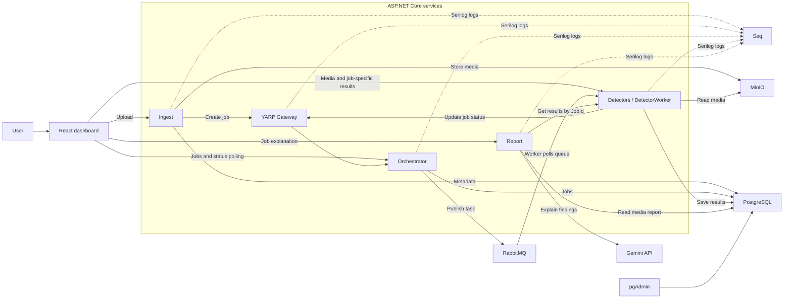
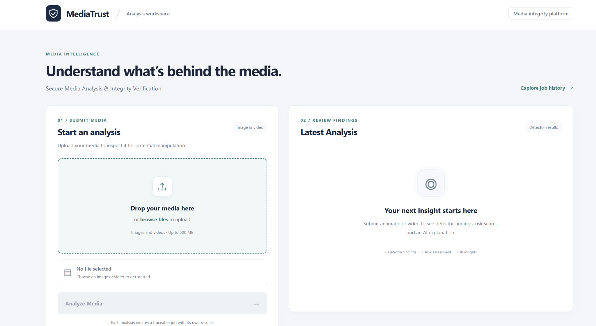
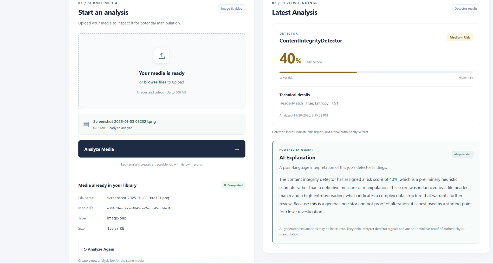
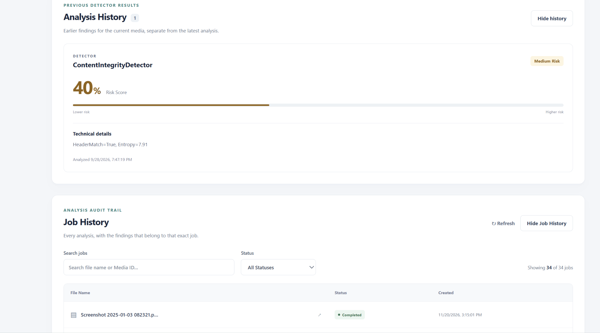
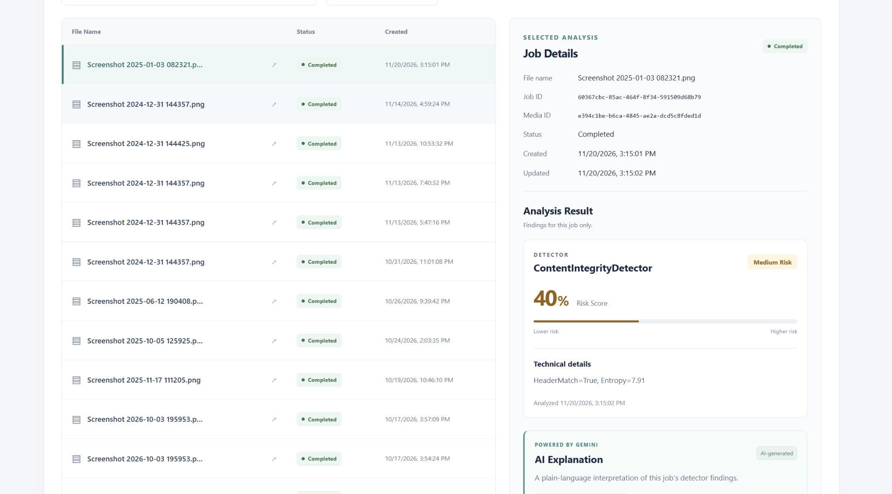

# MediaTrust

**Secure Media Analysis & Integrity Verification Platform**

## Overview

MediaTrust is a full-stack media integrity analysis platform built with React and ASP.NET Core services. Users can upload images and videos, inspect integrity signals, track asynchronous analysis jobs, re-analyze existing media without uploading it again, and explore job-specific detector results and analysis history. On demand, Gemini turns technical findings into a plain-language explanation.

Detector scores are **heuristic risk indicators**. MediaTrust does not establish whether media is authentic, fake, or manipulated.

## Key Features

- **Media upload:** image and video selection, drag-and-drop, filename display, and configured upload limits of 500 MB.
- **Duplicate media detection:** filename-based lookup returns existing media metadata without another upload or `MediaItem` insert.
- **Analyze Again:** creates a new `AnalysisJob` for existing media using the same `MediaId` and object key.
- **Asynchronous processing:** a RabbitMQ-backed detector worker processes queued jobs and updates their status.
- **Job History dashboard:** filename/Media ID search, status filtering, selectable rows, and a Job Details panel.
- **Job-specific DetectorResults:** results are associated with their originating `JobId`, independently of Latest Analysis.
- **Analysis History and Risk Score visualization:** previous detector results remain separate from the latest result, with low, medium, and high risk presentation.
- **AI-generated explanations:** Gemini interprets detector findings, with timeout and retry handling for selected failures.
- **Operational tooling:** Serilog/Seq logging, pgAdmin, and a Docker Compose local environment.
- **Automated backend tests:** 35 xUnit cases covering focused business logic without external services.

## Architecture

| Component | Responsibility |
| --- | --- |
| React frontend | Uploads media, polls analysis status, displays results and history, and requests explanations. |
| Ingest | Validates multipart uploads, checks filenames for duplicates, stores files and metadata, and requests job creation. |
| Gateway | YARP reverse proxy for `/media`, `/jobs`, `/detectors`, and `/reports`; used internally by Ingest and Detectors. |
| Orchestrator | Persists `AnalysisJob` records, publishes detector tasks, and serves job history/status updates. |
| RabbitMQ | Carries tasks through a durable direct exchange and queue with explicit acknowledgements. |
| Detectors | Runs `DetectorWorker`, retrieves media, calculates integrity signals, saves results, and reports job status. |
| Report | Aggregates media-level results and requests a Gemini explanation for a job-specific result. |
| PostgreSQL | Stores media metadata, analysis jobs, and detector results in the configured shared database. |
| MinIO | Stores uploaded media objects. |
| Gemini API | Generates explanatory text from detector name, score, and technical details. |
| Seq | Receives structured logs when its configured endpoint is reachable. |
| pgAdmin | Provides a browser-based PostgreSQL administration interface. |



The current frontend calls the exposed service ports directly; it does not route browser requests through the Gateway. The worker automatically polls RabbitMQ. `POST /detectors/run-once` also exists for manual execution, but is not required for the normal flow.

## Analysis Flow

1. The user selects an image or video and chooses **Analyze Media**.
2. Ingest checks the normalized filename against stored media. A duplicate returns existing metadata with `IsDuplicate = true`, without creating another job automatically.
3. For new media, Ingest writes the file to MinIO and its metadata to PostgreSQL.
4. Ingest requests job creation through the Gateway. Orchestrator persists an `AnalysisJob` with status `Pending`.
5. Orchestrator publishes a detector task containing the `JobId`, `MediaId`, object key, content type, and size to RabbitMQ.
6. `DetectorWorker` pulls the task and invokes the detector manager.
7. The manager updates the job to `Processing`, retrieves the media, and checks its header and sampled byte entropy.
8. A `DetectorResult` is stored with the originating `JobId` and `MediaId`.
9. The job becomes `Completed` on success; the failure path attempts to mark it `Failed`. The worker acknowledges successful tasks and requeues failed tasks.
10. React polls the latest job for the media and loads media-level detector results for **Latest Analysis** and **Analysis History**. Selecting a job in **Job History** separately fetches only that job's results.
11. On request, Report retrieves the selected job's detector results and asks Gemini to explain the most recent result within that job.

**MediaId identifies uploaded media; JobId identifies one analysis execution.** Analyze Again creates a new JobId for the same MediaId. Filename-based duplicate detection is not content hashing: different content with the same filename is treated as existing media.

The selected-job panel uses `GET /detectors/results/job/{jobId}`. Older jobs without an associated result display:

> No job-specific analysis result is available for this analysis.

### Main API endpoints

Paths below are relative to the listed service's local base URL.

| Service | Method and path | Purpose |
| --- | --- | --- |
| Ingest | `POST /media` | Multipart upload using the `file` form field. |
| Orchestrator | `POST /jobs` | Create an analysis job for existing media. |
| Orchestrator | `GET /jobs` | List jobs for Job History. |
| Orchestrator | `GET /jobs/media/{mediaId}` | Get the latest job by creation time for media. |
| Orchestrator | `PATCH /jobs/{jobId}/status` | Update job status. |
| Detectors | `GET /detectors/results/{mediaId}` | Retrieve media-level detector history. |
| Detectors | `GET /detectors/results/job/{jobId}` | Retrieve results belonging to one job. |
| Report | `GET /reports/media/{mediaId}` | Aggregate media-level findings. |
| Report | `GET /reports/explanation/{jobId}` | Generate a job-specific AI explanation. |

## Technology Stack

| Area | Technologies |
| --- | --- |
| Frontend | React 19, TypeScript, Vite, CSS |
| Backend | C#, .NET 10, ASP.NET Core, Entity Framework Core, Npgsql, YARP |
| Infrastructure | Docker Compose, RabbitMQ, PostgreSQL 16, MinIO, Seq, pgAdmin |
| AI and resilience | Gemini API over HTTP, custom AI retry/timeout handling, Polly for database startup retries |
| Logging | Serilog with console and Seq sinks |
| Testing | xUnit, Moq, EF Core InMemory |

## Detector Logic

`ContentIntegrityDetector` compares the declared content type against a small table of expected file signatures and calculates Shannon entropy over the first **up to 4 KB** of media bytes.

| Signal | Risk contribution |
| --- | ---: |
| Header does not match the expected signature | +0.6 |
| Sample entropy is greater than 7.2 | +0.4 |
| Maximum Risk Score | 1.0 |

An entropy value of exactly 7.2 adds no risk. Both signals together produce 1.0; neither produces 0. The UI displays the unchanged score as a percentage. Presentation/report thresholds are below 0.3 for low risk / `OK`, 0.3 to below 0.7 for medium risk / `Warning`, and 0.7 or above for high risk / `Critical`. Media-level reports use the maximum stored score for that MediaId.

**The risk score is a heuristic signal and is not a probability that the media is fake.** The implementation checks byte-level indicators; it does not perform comprehensive format validation, frame analysis, or deepfake detection. Unsupported signatures and naturally compressed files can raise risk signals.

## AI Explanation

Report sends the detector name, deterministic Risk Score, and technical details to Gemini; it does not send the media file in this request. The prompt asks for a concise, non-technical interpretation. **AI does not determine or alter the Risk Score**, and its output is not definitive proof of authenticity or manipulation.

The accessor makes up to **three attempts**, with a **15-second per-attempt request timeout** and delays of one then two seconds. It retries request timeouts and HTTP `503 Service Unavailable`; other HTTP errors are surfaced rather than retried. Caller cancellation is respected. Explanations are generated on demand and are not persistently cached.

## Running the Project

### Prerequisites

- Git.
- Docker Desktop running Linux containers, with Docker Compose available.
- .NET 10 SDK for local backend builds and tests; container builds use the SDK image.
- Node.js and npm. The installed Vite package requires Node `^20.19.0` or `>=22.12.0`; Node 24 is a suitable option.
- A Gemini API key for AI explanations. Uploads, detector processing, and unit tests do not require Gemini access.

### Environment Variables

Create `deploy/.env`, next to `docker-compose.yml`, with your own key:

```env
GEMINI_API_KEY=your_api_key_here
```

Compose maps this variable to `Gemini__ApiKey` in the Report container. **`.env` is intentionally excluded from Git. Never commit API keys or secrets.** Existing local files should be edited without overwriting unrelated settings. No credentials are reproduced in this README.

### Backend and infrastructure

From the repository root in PowerShell:

```powershell
cd deploy
docker compose up -d --build
docker compose ps
```

Ingest, Orchestrator, and Detectors apply EF Core migrations at startup, with retries for database startup failures. Services can take time to become ready; inspect a failing service with `docker compose logs --tail 100 <service>`.

Each backend Dockerfile restores and publishes its own `.csproj` into a service-specific output directory. The final ASP.NET runtime image contains that service and its dependencies, without other MediaTrust services or test assemblies. The root `.dockerignore` excludes host build outputs, tests, frontend files, and local environment secrets from the build context.

### Frontend

Open a second PowerShell terminal at the repository root:

```powershell
cd mediatrust-ui
npm install
npm run dev
```

Open **http://localhost:5173**. Backend CORS policies allow this exact origin. If Vite selects another port because 5173 is occupied, free port 5173 and restart it.

To create a frontend production build:

```powershell
npm run build
```

### Local ports

| Service | Host address / port |
| --- | --- |
| React / Vite | http://localhost:5173 |
| Gateway | http://localhost:8080 |
| Ingest | http://localhost:8081 |
| Orchestrator | http://localhost:8082 |
| Detectors | http://localhost:8083 |
| Report | http://localhost:8084 |
| RabbitMQ | AMQP `5672`; management http://localhost:15672 |
| PostgreSQL | TCP `5432` |
| MinIO | S3 API http://localhost:9000; console http://localhost:9001 |
| Seq | http://localhost:5341 |
| pgAdmin | http://localhost:5050 |

Administration credentials remain in local configuration and are intentionally omitted here.

### Local setup notes and limitations

- **Seq addressing:** Compose sets `Seq__ServerUrl=http://seq:80` for all five backend services, overriding the `Seq:ServerUrl` values in their JSON configuration. Containers use Seq's internal port 80; the host-facing address remains `http://localhost:5341` through the `5341:80` mapping.
- **Local-development storage:** PostgreSQL, RabbitMQ, and MinIO have no explicit named volumes or bind mounts in Compose, but their images declare data volumes. Inspection of the local containers confirmed anonymous volumes at `/var/lib/postgresql/data`, `/var/lib/rabbitmq`, and `/data`, respectively. These are persistent Docker volumes, not just container filesystem storage; however, anonymous volumes do not provide stable, Compose-declared names for reuse after containers are removed. Only Seq has an explicitly declared named volume (`seq-data`). This is a local-development storage-management limitation, not an absence of persistence; important data needs an explicit retention and backup plan.

## Tests

The suite contains **35 automated test cases** across four projects:

| Test project | Cases | Focus |
| --- | ---: | --- |
| `MediaTrust.Detectors.Tests` | 13 | Header/entropy scoring combinations, thresholds, score bounds, and entropy calculation. |
| `MediaTrust.Report.Tests` | 13 | Job-specific explanations, AI arguments and response mapping, missing results, risk-status thresholds, and report aggregation. |
| `MediaTrust.Orchestrator.Tests` | 4 | Latest-job lookup, creation-time ordering, MediaId filtering, and missing jobs. |
| `MediaTrust.Ingest.Tests` | 5 | Duplicate metadata reuse without extra writes/storage/job creation, filename normalization, and invalid uploads. |

From the solution root:

```powershell
dotnet test MediaTrust.sln
dotnet build MediaTrust.sln -c Release
```

Tests use mocks and isolated EF Core in-memory databases. They do not start application hosts, read a real Gemini key, or require Docker, PostgreSQL, RabbitMQ, MinIO, or Gemini. Initial dependency restoration requires NuGet access unless packages are cached.

The most recent implementation verification passed all 35 tests and completed the Release build with zero warnings and errors. These are focused backend tests, not end-to-end verification of the running stack. See [tests/README.md](tests/README.md) for details and coverage limits.

## Screenshots

### Analysis Workspace

The main MediaTrust workspace provides media upload, analysis results, and direct access to previous analysis jobs.



### Latest Analysis & AI Explanation

Each analysis displays the detector findings, heuristic risk score, technical signals, and a plain-language explanation generated with Gemini.



### Analysis History

Previous detector results for the same media remain available separately from the latest analysis, allowing repeated analyses to be compared over time.



### Job History & Job-Specific Results

Each analysis execution has its own Job ID and job-specific detector result, providing traceability between uploaded media and individual analysis runs.



## Project Structure

```text
MediaTrust/
├── mediatrust-ui/              # React / TypeScript dashboard
├── src/
│   ├── Gateway/                # YARP routing
│   ├── Ingest/                 # Upload and duplicate handling
│   ├── Orchestrator/           # Job lifecycle and task publication
│   ├── Detectors/              # Background worker and integrity scoring
│   └── Report/                 # Reports and Gemini explanations
├── tests/
│   ├── MediaTrust.Detectors.Tests/
│   ├── MediaTrust.Report.Tests/
│   ├── MediaTrust.Orchestrator.Tests/
│   ├── MediaTrust.Ingest.Tests/
│   └── Directory.Build.props   # Shared test configuration
├── deploy/                    # Docker Compose and local environment file
├── docs/images/               # Screenshot contribution instructions
└── MediaTrust.sln
```

## Reliability / Engineering Highlights

- **Service separation and dependency injection:** controllers, managers, repositories, and accessors separate transport, business logic, and external dependencies.
- **Message-driven execution:** RabbitMQ decouples upload requests from detector work. Failed worker tasks are requeued; there is no bounded processing retry or dead-letter workflow implemented yet.
- **Traceability:** one MediaId can have multiple JobIds, with job-specific DetectorResults and timestamps.
- **Duplicate prevention:** filename lookup avoids repeated uploads; Analyze Again explicitly creates another analysis execution.
- **External-call resilience:** Gemini has bounded retry/timeout handling; database initialization uses Polly retries.
- **Repeatable local tooling:** Docker Compose, structured logging configuration, environment-based Gemini key injection, and service-independent business-logic tests.

## Future Improvements

- Additional detectors and stronger file-format validation.
- Authentication, authorization, and user-owned media.
- Persistent AI explanation caching.
- Integration and browser end-to-end tests, plus deployment/CD automation.
- Bounded queue retries, dead-letter handling, and improved observability.
- Explicitly managed persistent infrastructure storage and cloud deployment.
